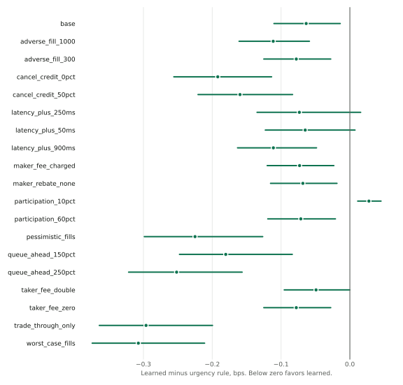
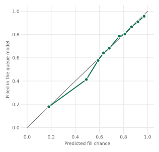

# Benchmark report

Generated by `uv run mreplay report` from saved results. Do not edit by hand.

Every order here is simulated, and the market is a seeded synthetic feed. Nothing here describes a real venue. Economic results are exploratory. See [assumptions.md](assumptions.md) and [data_rights.md](data_rights.md).

## Result

**The learned policy passed the frozen rule against the urgency rule on this synthetic feed.** It cost 0.064 bps less per order (95% interval 0.014 to 0.110 bps), across 34 trading days.

| Frozen check | Learned | Urgency rule | Passed |
|---|---:|---:|---|
| 95% interval of the mean paired difference below 0 bps | -0.110 to -0.014 | | Yes |
| P95 no more than 0.5 bps above the baseline | 2.690 | 3.072 | Yes |
| Forced lots no more than 1 point above the baseline | 1.21% | 7.93% | Yes |

Unit of replication: one trading day. Denominator: 909 parents over 34 days, with 9 parents excluded for every strategy (halt: 6, invalid book: 3).

## Cost by strategy

Test days only. Positive numbers are costs. Each row trades the same parents.

| Strategy | Parents | Mean bps | Median bps | P95 bps | Finished before deadline | Forced lots | Maker lots |
|---|---:|---:|---:|---:|---:|---:|---:|
| Learned policy | 909 | -0.762 | -0.500 | 2.690 | 85.6% | 1.21% | 77.5% |
| Urgency rule | 909 | -0.699 | -0.546 | 3.072 | 37.7% | 7.93% | 82.3% |
| Passive only | 909 | -0.488 | -0.457 | 4.266 | 35.0% | 15.37% | 84.6% |
| Fitted Q comparator | 909 | 1.171 | 0.674 | 5.947 | 19.9% | 19.55% | 37.7% |
| Equal time | 909 | 2.105 | 1.399 | 4.693 | 96.1% | 0.29% | 0.0% |
| Volume schedule | 909 | 2.106 | 1.393 | 4.685 | 96.3% | 0.29% | 0.0% |
| Oracle volume schedule (not achievable) | 909 | 2.117 | 1.420 | 4.842 | 95.7% | 0.31% | 0.0% |
| Random (after Hafsi and Vittori) | 909 | 2.459 | 1.525 | 6.054 | 54.3% | 8.37% | 0.0% |
| Immediate cross | 909 | 2.518 | 1.669 | 4.348 | 98.2% | 0.11% | 0.0% |

The oracle schedule sees each session's final volume, so no real trader could run it. It is shown for scale and was never eligible as the baseline.

| Learned minus | Mean difference bps | 95% interval | Days |
|---|---:|---|---:|
| Immediate cross | -3.270 | -5.692 to -1.967 | 34 |
| Equal time | -2.858 | -5.360 to -1.514 | 34 |
| Volume schedule | -2.859 | -5.362 to -1.515 | 34 |
| Passive only | -0.274 | -0.409 to -0.136 | 34 |
| Urgency rule | -0.064 | -0.110 to -0.014 | 34 |
| Random (after Hafsi and Vittori) | -3.211 | -6.074 to -1.671 | 34 |
| Fitted Q comparator | -1.933 | -2.797 to -1.417 | 34 |
| Oracle volume schedule (not achievable) | -2.870 | -5.371 to -1.525 | 34 |

## Session types

Thresholds were fixed on training days: volatile means 60 s midpoint volatility of at least 4.34 ticks, and sparse means a median touch of at most 12.8 lots. Sparse takes priority. Small day counts make these intervals wide.

| Session type | Days | Learned mean bps | Urgency rule mean bps | Difference bps | 95% interval |
|---|---:|---:|---:|---:|---|
| calm | 26 | -0.259 | -0.167 | -0.092 | -0.139 to -0.047 |
| sparse | 6 | -3.012 | -3.073 | 0.060 | -0.065 to 0.228 |
| volatile | 2 | -0.579 | -0.511 | -0.068 | -0.095 to -0.041 |

## What changes under other fill assumptions

Strategies stay frozen in every scenario. Nothing is refit, and the policy keeps its original fee beliefs.

- The paired result reverses, with the interval above zero, in 1 of 18 moved scenarios: participation_10pct.
- The interval reaches zero in 2 more, so the evidence for a difference is lost there: latency_plus_250ms, latency_plus_50ms.
- The cheapest strategy under base assumptions is Learned policy. It loses that place in 1 scenario: participation_10pct.
- Under worst_case_fills the cheapest strategy is Learned policy, at 1.093 bps.

| Scenario | Cheapest strategy | Learned minus baseline bps | 95% interval | Rule passes | Evidence changes |
|---|---|---:|---|---|---|
| base | Learned policy | -0.064 | -0.110 to -0.014 | Yes | No |
| adverse_fill_1000 | Learned policy | -0.111 | -0.161 to -0.059 | Yes | No |
| adverse_fill_300 | Learned policy | -0.078 | -0.125 to -0.028 | Yes | No |
| cancel_credit_0pct | Learned policy | -0.192 | -0.256 to -0.114 | Yes | No |
| cancel_credit_50pct | Learned policy | -0.160 | -0.221 to -0.083 | Yes | No |
| latency_plus_250ms | Learned policy | -0.073 | -0.135 to 0.016 | No | Yes |
| latency_plus_50ms | Learned policy | -0.065 | -0.123 to 0.007 | No | Yes |
| latency_plus_900ms | Learned policy | -0.111 | -0.163 to -0.048 | Yes | No |
| maker_fee_charged | Learned policy | -0.073 | -0.120 to -0.023 | Yes | No |
| maker_rebate_none | Learned policy | -0.068 | -0.115 to -0.019 | Yes | No |
| participation_10pct | Passive only | 0.028 | 0.011 to 0.045 | No | Yes |
| participation_60pct | Learned policy | -0.071 | -0.119 to -0.021 | Yes | No |
| pessimistic_fills | Learned policy | -0.225 | -0.299 to -0.127 | Yes | No |
| queue_ahead_150pct | Learned policy | -0.180 | -0.248 to -0.084 | Yes | No |
| queue_ahead_250pct | Learned policy | -0.252 | -0.321 to -0.157 | Yes | No |
| taker_fee_double | Learned policy | -0.049 | -0.095 to -0.000 | Yes | No |
| taker_fee_zero | Learned policy | -0.078 | -0.125 to -0.028 | Yes | No |
| trade_through_only | Learned policy | -0.296 | -0.364 to -0.200 | Yes | No |
| worst_case_fills | Learned policy | -0.307 | -0.374 to -0.211 | Yes | No |

## Fill model

Boosted trees beat logistic regression at an equal budget of 12 random trials each, on later training days.

| Measured on | Rows | Boosted Brier | Logistic Brier | Base rate Brier | Boosted calibration error |
|---|---:|---:|---:|---:|---:|
| Training days 50 to 59 | 8735 | 0.1444 | 0.1663 | 0.1934 | 0.0230 |
| Test days | 29718 | 0.1637 | not run | 0.2171 | 0.0153 |

The label is the queue model's own output: did a 16 lot probe fill within 15 s or its deadline. Calibration here shows the model learned the simulator, not that the simulator is right.

## Modeled against observed

| Quantity | Kind | Value |
|---|---|---:|
| Probe fill rate, 16 lots | Modeled | 74.6% |
| Fill chance of recorded touch orders by 15 s, Kaplan-Meier | Observed in the feed | 86.4% |
| Recorded touch orders followed | Observed | 74,870 |
| Share cancelled before the horizon | Observed, censored | 79.4% |
| Price move after a probe filled | Modeled fill, observed price | -0.385 ticks |
| Price move after a probe did not fill | Modeled fill, observed price | 1.118 ticks |

Recorded orders are smaller than probes, so their rate should run higher. With 79% censored, the Kaplan-Meier figure assumes cancels carry no information about fills. Real traders cancel when they expect trouble, so treat it as an upper estimate.

## Speed and memory

Measured on Apple M5 Pro, one core, day 100 with 85,065 events, over 15 runs each. Other work shared this Mac: the 1 minute load average was 38.2 before the run and 43.2 after it. Events per second therefore come from the best run, the one disturbed least. The compiled replay was profiled only after its ledgers matched the reference exactly.

| Path | Events per second, best run | Seconds, median | Range |
|---|---:|---:|---|
| Book replay, Python | 1,212,820 | 0.1589 | 0.0701 to 0.3633 |
| Book replay, compiled C | 9,514,036 | 0.0110 | 0.0089 to 0.0121 |
| Replay and execution, Python | 345,115 | 0.3015 | 0.2465 to 0.3694 |
| Replay and execution, compiled C | 9,775,339 | 0.0107 | 0.0087 to 0.0123 |

Execution rows cover 4 strategies on 27 parents in one pass. The Python execution time includes those strategies' decisions, and the compiled time replays their recorded commands, so that speedup of 28.3x does not compare like with like. The book speedup of 7.8x, best run against best run, does. The compiled book checksum also updates after each event, which slows it slightly.

| Memory, peak | MB |
|---|---:|
| Python book replay, whole process | 184.3 |
| Compiled book replay, whole process | 21.4 |

Each policy decision took 2521 us at the median and 3428 us at p95, over 810 decisions. Decisions in this study run every 2 s, so model speed does not limit it.

## Correctness evidence

| Check | Result |
|---|---:|
| Tests passing | 140 |
| Line coverage, engine modules | 99% |
| Line coverage, whole package | 81% |
| Fuzz cases, C against Python, under ASan and UBSan | 100,000 |
| Events across fuzz cases | 51,512,685 |
| Simulated fills compared | 5,904,329 |
| Ledger divergences | 0 |
| Book divergences | 0 |

## Validation record

The tuning stage chose `learned_b30_c0.0_f4.0_w99.0` and `urgency_30` on validation days, then the freeze named `urgency` as the baseline. Failed experiments are in [experiments.md](experiments.md).

## How to reproduce

| Item | Value |
|---|---|
| Final run commit | `00fa360efbbfb6772710b5daa0a0b1f77cbbf0e8` |
| Input hash | `6ed7b002482ea576103c31a31f6676e3bf713c0e6d8f81281873d970c5b85815` |
| Fitted artifact hash | `47a61d768ac869a3f69bf87303e010dfaa776b64e09160f6dcf9616502c33ede` |
| Raw results hash | `463eebd712c819a897c56b3eab0b8dcd7fe0f55cb31a7c4928f8ea2435f69f0f` |
| Seeds | plan 20261104, pipeline 11, bootstrap 5 |
| Machine | Apple M5 Pro, 18 cores, Python 3.12.7 |

Raw per-parent measurements are in `results/raw/`. Plots are built from them, never the other way around.
